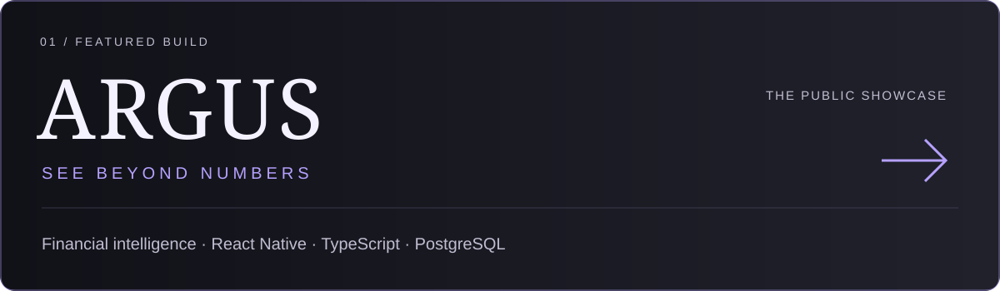
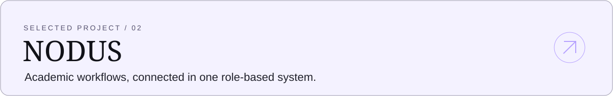
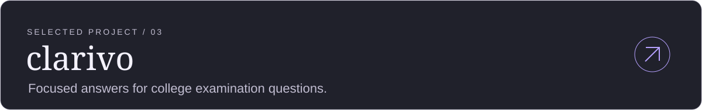

  <a href="https://github.com/guru-six3/ARGUS-showcase">Explore ARGUS</a> &nbsp; · &nbsp;
  <a href="#selected-projects">Selected projects</a> &nbsp; · &nbsp;
  <a href="https://github.com/guru-six3?tab=repositories">All repositories</a>

 

I build applications that bring clarity to complicated workflows.
My projects span mobile financial intelligence, academic systems and practical AI tools.

The parts I care about most: **correct data, understandable behaviour, privacy and an interface that feels considered.**

 

Transaction capture, editable review, budgets, explainable guidance and Financial Journey.
The showcase presents the product; the application source stays private.
Development and validation are ongoing, not a public-release claim.

[Watch the demo and explore ARGUS →](https://github.com/guru-six3/ARGUS-showcase#watch-the-demo)

 

## Selected projects

Student, staff and administrator portals for attendance, marks, fees, timetables and notices.

Cinema discovery and booking, with an intelligent audience experience.

TF-IDF matching, related-question suggestions and date-aware countdowns.

 

### Tools behind the work

**TypeScript** · **Python** · **React Native** · **Node.js** · **PostgreSQL**

---

Build something useful. Understand how it works. Make it better.
