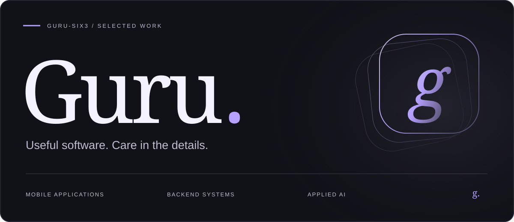

  

  <a href="#selected-work">Selected work</a> &nbsp; / &nbsp;
  <a href="#currently-building">Currently building</a> &nbsp; / &nbsp;
  <a href="https://github.com/guru-six3?tab=repositories">All repositories</a>

 

I build applications that make complicated workflows easier to understand, from
academic systems to financial intelligence and focused AI tools.

I care about the details behind the interface: clear data flows, useful feedback,
privacy, and explanations people can actually follow.

## Selected work

| Project                                               | What it does                                                                                         | Primary language |
| :---------------------------------------------------- | :--------------------------------------------------------------------------------------------------- | :--------------- |
| **[NODUS](https://github.com/guru-six3/NODUS)**       | Role-based academic management with student, staff and administrator portals.                        | TypeScript       |
| **[clarivo](https://github.com/guru-six3/clarivo)**   | A college examination FAQ chatbot with TF-IDF matching, related questions and date-aware countdowns. | Python           |
| **[cineseat](https://github.com/guru-six3/cineseat)** | Cinema discovery, booking and an intelligent audience experience.                                    | Python           |

## Currently building

### ARGUS

**SEE BEYOND NUMBERS**

A financial intelligence application bringing transactions, budgets, explainable
guidance and location-based spending into one place.

React Native · TypeScript · Node.js · PostgreSQL

Private repository. Development and validation are ongoing; this is not a public-release claim.

 

## Working with

**TypeScript** &nbsp; **Python** &nbsp; **React Native** &nbsp; **Node.js** &nbsp; **PostgreSQL**

Mobile interfaces, backend APIs, deterministic intelligence and practical tools.

---

  Build something useful. Understand how it works. Make it better.

